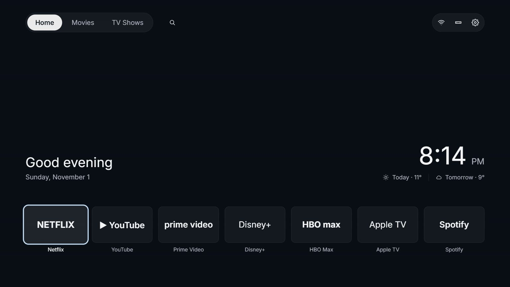
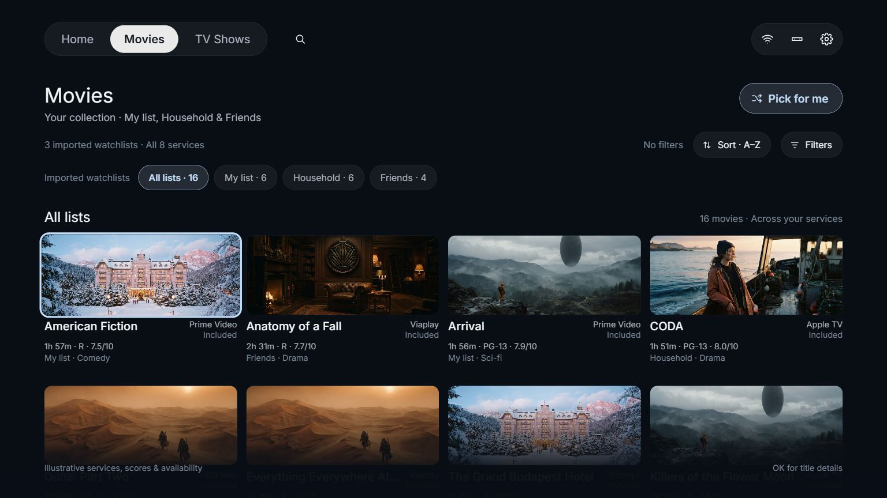
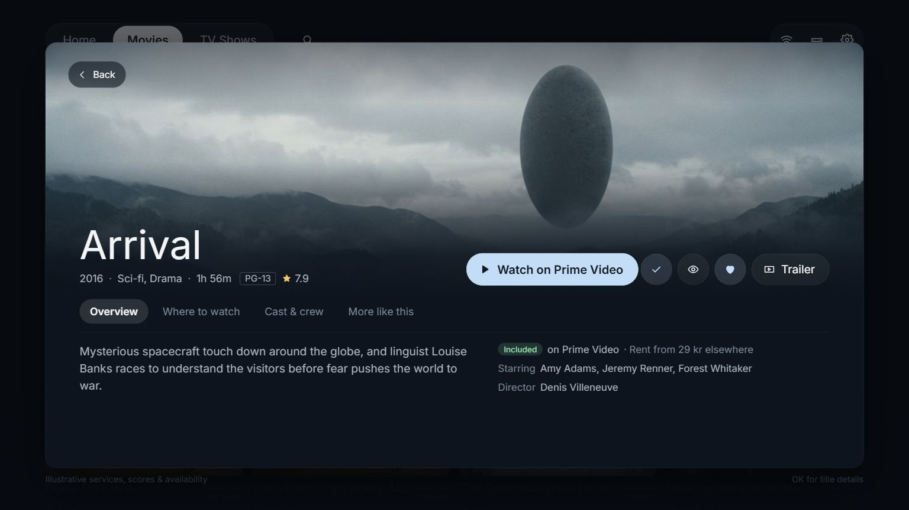
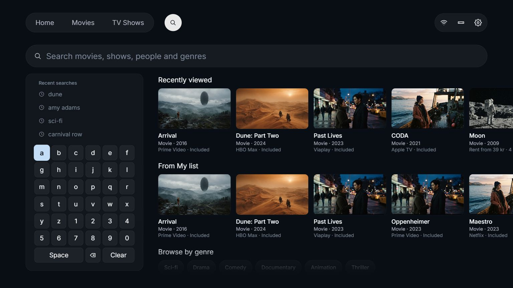

# HomeTV Launcher

A home screen for Android TV that you drive with the remote. Your apps and inputs are up front, and your household's
movies and shows are one press away, with the services that have them, a title preview, search, Pick for me and the
weather. No ads and no analytics, and Home works with the network off.

**[Try it in your browser](https://rebeccamcfadden.github.io/cleanyourtv/)**: the keyboard stands in for the remote.

| | |
|---|---|
|  |  |
| *Home: greeting, clock, weather and your apps* | *Movies: your lists, Sort, Filters and Pick for me* |
|  |  |
| *Title preview: Watch, Seen, Favorite, Trailer and tabs* | *Search: typo-tolerant, results as you type* |

*Screenshots of the web demo.*

## Install

On a computer on the same Wi-Fi as an Android TV or Google TV, with this repo cloned, paste [PROMPT.md](PROMPT.md) into
Claude Code, [Codex](https://github.com/openai/codex), [Gemini CLI](https://github.com/google-gemini/gemini-cli) or
another coding assistant with shell access, and fill in your TV model. It backs up the TV, disables the manufacturer's
bloat (nothing is uninstalled, and one command puts it back), builds the launcher, makes it Home and checks each step
with screenshots from the TV. About fifteen minutes.

Before that, on the TV: Settings → Device Preferences → About → press OK on **Build** seven times → back → Developer
options → **USB debugging** on (and Network/ADB debugging if you see it). Keep the TV on, and accept "Allow USB
debugging?" when it appears.

It needs Android 8.0 or newer. Fire TV keeps its own home screen (the debloat half still works), and Samsung Tizen and
LG webOS are different systems: [supported TVs](docs/supported-tvs.md).

## Documentation

| | |
|---|---|
| [The launcher](docs/launcher.md) | What each screen does, Launcher settings, themes, remote keys, building it yourself and its config |
| [Supported TVs](docs/supported-tvs.md) | What works where, and the tested debloat list for each model, in [`examples/`](examples/) |
| [Doing it by hand](docs/tools.md) | The scripts and tools without an assistant, and how they protect Home |
| [Restoring and updates](docs/restore.md) | One line puts the TV back; what to do after a firmware update or when something goes wrong |
| [Questions people ask](docs/faq.md) | Is it safe, firmware updates, closing ADB, blocking ads, going online |
| [Troubleshooting](docs/TROUBLESHOOTING.md) | Everything that bit us, by symptom |
| [Phone notes](docs/phone-notes.md), [Themes](themes/README.md), [Another home](docs/REMOTE.md), [The microphone](docs/microphone.md) | Send a watch-list note from a phone, the nine themes, helping someone remotely, what can be said about listening |

## Build and contribute

```sh
cd design_preview && npm install && npm run dev    # the web prototype, the spec for flows and behaviour
```

```sh
cd launcher && ./gradlew --no-daemon testReleaseUnitTest lintRelease assembleRelease
```

The launcher needs JDK 17 and Android SDK platform 34. Start with [AGENTS.md](AGENTS.md) (it is for people too) and
[docs/rework.md](docs/rework.md), which hold the rules, decisions and workflow; [BACKLOG.md](BACKLOG.md) lists what is
mocked or deferred, and [CONTRIBUTING.md](CONTRIBUTING.md) how to add your TV's list. Security problems are reported
privately: [SECURITY.md](SECURITY.md).

## Credits

HomeTV Launcher is a fork of [CleanYourTV](https://github.com/Gathin23/cleanyourtv) by Gathin and its contributors
(MIT). The debloat tools, the TV lists and the safety rules are theirs; so is the project's story, its press and its
community, which you will find in [their README](https://github.com/Gathin23/cleanyourtv#readme). The network features
draw on [cleanyourtv-ui](https://github.com/matheus-caldeira/cleanyourtv-ui) (MIT, with code from Free My TV, also
MIT); a file adapted from it says so at the top. This product uses the TMDB API but is not endorsed or certified by
TMDB.

## Legal

- This is an independent open-source project. It is not affiliated with, endorsed by or sponsored by any TV maker or
  platform. Brand and model names are used only to say which TV a list was tested on, and remain the trademarks of
  their owners.
- It works only through settings the TV itself offers to its owner: Developer options, ADB debugging and Android's own
  `pm disable-user`, the same switch as Settings > Apps > Disable. It does not root the TV, flash firmware, or bypass
  any lock, DRM or copy protection, and the repo contains no manufacturer software, firmware or APKs.
- Nothing is uninstalled, and `tools/restore.sh` puts back what the debloat list disabled. You run it on a TV you own,
  at your own risk, and changing a TV's software may affect its warranty or support.
- Everything here is provided as is, without warranty of any kind, under the MIT licence: see [`LICENSE`](LICENSE).
