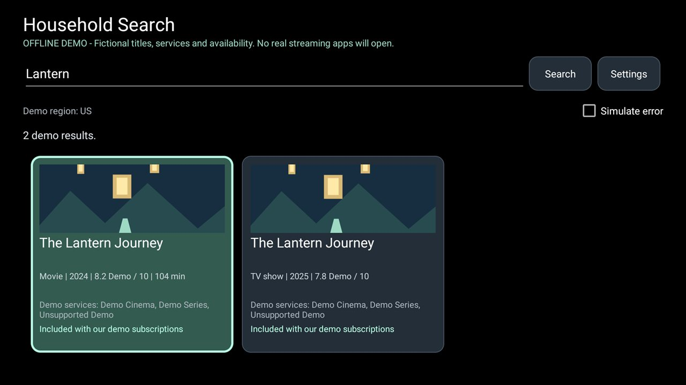

# Household TV (native-first unified homepage)

A native Java Android TV add-on with Search Everywhere, Continue Watching and Apps. It evolves the
existing search prototype rather than replacing it. It uses the existing
[module-card contract](../../docs/modules.md); core launcher code and the default Home handler remain unchanged.

**This is a native-first increment, not the completed live-catalog search product.** Normal search
uses real installed apps and readable native TV content. The separate **Demo catalog** still contains
six original fictional titles and providers. No live TMDB search, guessed provider links, accounts,
player or inferred subscriptions have been added.

## Unified homepage

- An obvious search button, horizontal Continue Watching cards and installed Apps.
- Native search combines readable Watch Next entries, published preview-channel content and installed
  apps. Source problems leave partial app results usable and expose a recoverable notice.
- Continue Watching uses browsable Watch Next CONTINUE/NEXT entries, not promotional previews,
  NEW suggestions or native WATCHLIST entries. Missing progress stays hidden; known zero and complete
  progress remain exact. Position/duration use milliseconds; season/episode display numbers survive.
- Selecting native content preserves its originating app's playback action, data and extras, while
  pinning execution to that app. Cross-package components/packages/selectors and unsafe URI schemes
  are rejected. Grant flags, clip data and browser fallback extras are removed.
- An unusable/missing playback intent falls back to that app's TV/ordinary launcher activity with an
  explicit notice. If neither works, a recoverable message keeps the selection. There is no arbitrary
  browser redirect or claim that an accepted intent proves actual playback.
- Left/Right moves without wrapping. Up/Down crosses rows; Up from Continue Watching returns to Search.
  Back from Search returns to this homepage; Back from the homepage returns to the existing launcher.
- Data refreshes on return to foreground and through Refresh, without a background service or polling.

The normal app entry is `HomeActivity`; `SearchActivity` remains internal and retains the existing
fixture grid, metadata, provider choice and focus behavior. **Demo catalog** explicitly opens that
original mode. The physical Home button still goes to CleanYourTV, not this add-on. This is not a
default-Home replacement: repository policy requires a separate launcher fork for networking/new
permissions in core or a changed default Home experience.

## Demo catalog (retained vertical slice)

- Search movies and TV together; try `Lantern`, `Orbit`, `Small`, `Paper`, or `Train`.
- Results distinguish identically named movies and shows using type/year and stable namespaced IDs.
- Original local artwork for Lantern; other titles exercise missing-artwork placeholders.
- Metadata, provider choice, subscription highlighting and configurable demo country.
- Empty query, loading, no results, simulated recoverable error and explicit unsupported launch.
- Demo title, provider-search and provider-home destinations, with Back/focus restoration.
- JVM tests and instrumented TV UI tests.
- Tested on a TV reporting **BeyondTV, Android 9**, firmware `PPR1.180610.011 release-keys`.
  The original seven instrumented tests passed. The release app was also checked for Home-tile entry,
  keyboard Enter submission, the demo title destination, cold start and Back to Home.



## Permissions

**`android.permission.READ_TV_LISTINGS`** reads other apps' searchable TV-provider rows. Home has a
permission/settings button; denial leaves apps and demo search usable. Privileged `ACCESS_ALL_EPG_DATA`
is neither requested nor required. No `INTERNET`, microphone, location, accessibility or storage access.

Narrow package queries cover MAIN/LEANBACK_LAUNCHER, MAIN/LAUNCHER and the TV provider, without
`QUERY_ALL_PACKAGES`. Disabled/non-exported apps and this add-on are excluded; TV activities take
precedence over ordinary launcher activities.

Artwork supports installed-app icons, original fixture art and readable `content:` /
`android.resource:` posters. **HTTPS posters remain placeholders** in this offline increment.
Local artwork is decoded off-main-thread, sampled to at most 640 pixels per edge, with a 2 MiB input
limit, 4 MiB memory cache and bounded queue. Late responses cannot paint a recycled card.
There is no background service, polling, ads, analytics or telemetry.

## Build and install

Requires JDK 17, Android SDK platform 34 and build-tools 34.0.0, like the launcher.
Set `JAVA_HOME` to JDK 17 and set `ANDROID_HOME` to your SDK (or create ignored `local.properties`).
From the repository root on Windows:

```powershell
Set-Location addons\household-search
.\gradlew.bat --no-daemon testReleaseUnitTest lintRelease assembleRelease assembleDebugAndroidTest
```

The release APK is `app\build\outputs\apk\release\app-release.apk`.
Build outputs are ignored; do not commit APKs.

With a deliberately connected, authorised test TV:

```powershell
adb install -r app\build\outputs\apk\release\app-release.apk
adb shell am start -n dev.household.tvsearch/.HomeActivity
```

The release currently uses the local debug signing key, as other small add-ons do.
Keep the same key for updates on your TV. A published version needs your own maintained signing key,
kept out of Git; module-card approval is pinned to the signing certificate.

## Home integration

On returning Home, approve **Household Search** in the module-card prompt, then use the launcher's
existing tile/reorder controls to put it in the dock. Its focused state is the launcher's normal one.
There is also an ordinary TV app tile when its card is hidden.

The module-card label is retained from the prototype to preserve label/certificate approval. The
ordinary app tile is now named **Household TV**. Both open the unified add-on homepage.

Optional: put `dev.household.tvsearch` in your personal theme's existing `top_bar_apps` list.
That moves the app to the top bar rather than copying it. The dock is the initial recommendation
because the launcher already restores tile focus after an application transition.

No launcher source, launcher permissions, Home handling or default configuration needs changing.

## Remote controls

| Location | Action |
|---|---|
| Query | OK opens the system keyboard; submit Search, Done or Enter, or use the Search button |
| Results | D-pad moves; row ends and bottom do not wrap; Up from the first row returns to Search |
| Result | OK opens metadata and the provider list |
| Providers | D-pad chooses an explicit offer; OK resolves/launches only that provider |
| Unsupported message | Close/Back returns to the same provider |
| Demo destination | Return/Back returns to the title/provider dialog |
| Details | Close/Back restores the selected result |
| Search screen | Back dismisses the IME when shown, otherwise leaves the add-on normally |

The result selection, query, grid state, error simulation and provider-dialog selection are saved
across Activity recreation. Text that has been typed but not submitted is saved separately.

## Demo providers and fallback behavior

| Provider | Title | Search | App home | Web | Verification |
|---|---|---|---|---|---|
| Demo Cinema | Movie fixtures | Unsupported | In-app demo | None | DEMO only |
| Demo Series | Unsupported | In-app demo with title | In-app demo | None | DEMO only |
| Unsupported Demo | Unsupported | Unsupported | Unsupported | None | Unsupported |

Choose Demo Cinema on the Lantern movie to exercise TITLE; choose it on the Lantern TV show to
exercise APP_HOME; choose Demo Series to exercise SEARCH. Unsupported Demo shows a recoverable
message and never opens another provider.

The pure resolver orders candidates TITLE -> SEARCH -> APP_HOME -> WEB and advances after
reported execution failures. Unit tests exercise missing applications, web-only fallback, exhausted
candidates, rejected links and failures at each level. The demo resolver's Android path refuses
non-demo catalog targets. Native published intents use the same execution boundary through `openMedia`,
with the owner-pinning and explicit app-home fallback described above.
A failed `startActivity` is recoverable; an accepted intent
cannot prove that a real provider actually displayed the requested title.

No provider-specific real URI has been invented or declared verified. Live adapters must distinguish
device-verified links, links needing testing, unsupported capabilities and fallback-only providers.

## Region and subscriptions

Settings accepts a two-letter ISO country code. The initial suggestion uses Android's locale
country; if absent, **US is explicitly a demo default**, not a determination of the household's
streaming market. All countries currently receive fictional offers. Live integration must confirm
a supported market before making availability requests.

Demo Cinema starts enabled as a **shared demo subscription**; Demo Series starts disabled.
These are local configuration, not account/entitlement checks. Rental, purchase, free/ad-supported
and unknown offers never become included because a subscription is configured. Paid channel/tier
requirements must match separately. A region change creates a new request context.

Demo preferences contain the country and subscription toggles, in private app storage,
with Android backup disabled. Queries are not persisted as recent-search history.
Home separately remembers whether TV-listings permission has been requested.

## Architecture and next increment

- `domain`: immutable `MediaEntity`, existing `MediaTitle`, `ProviderAvailability`, `Subscription`, `LaunchTarget`.
- `MediaEntity`: typed/namespaced ID, optional TMDB ID, title/subtitle/artwork, provider/package,
  original playback intent, position/duration, season/episode and source. Catalog entries retain their
  existing `MediaTitle` rather than duplicating metadata. No watchlist/profile model is added.
- `data`: existing service interfaces/fixtures, `TvProgramMapper`, `NativeMediaSource` and immutable
  `NativeMediaSnapshot`. Cursor/provider objects never reach the UI.
- `SearchController`: explicit search states; background work and stale-response suppression.
- `SearchResultsAdapter` / `SearchActivity`: existing grid/dialog/focus code now renders common entities.
- `HomeActivity` / `MediaRowAdapter`: the small homepage uses the same entities, presentation,
  artwork loader and Android launch boundary; the new row adapter uses RecyclerView's existing DiffUtil.
- `launch`: provider adapters, pure resolver, Android execution boundary.

The fake catalog's normalized IDs are `fixture:movie:<id>` and `fixture:tv:<id>`.
Future APIs get their own namespaces and ID mappings; UI code must never receive raw API responses.
Fixture availability is joined locally for each result; do not copy that per-result request strategy
into a live API without batching/caching/lazy hydration and separate availability-error states.

`NativeMediaSource` queries without selections or sorting, then filters/sorts in memory. It reads at
most 2,048 rows per table and reports truncation. Unsupported tables, null cursors, incomplete rows
and refused access produce visible source notices. Previews never become resume cards.
Native search deduplicates identical owner/playback/title/episode tuples across sources, not titles
alone, so distinct episodes and providers survive.
See [Reading Continue watching](../../docs/watch-next.md) for access limits: some apps publish nothing
or keep their rows non-searchable. A permission-holding application, not ADB shell, performs the probe.

### Reference comparison

The requested forks were studied as architectural references, not copied:

| Reference | Ideas retained | Not adopted |
|---|---|---|
| [TMDB client](https://github.com/matheus-caldeira/cleanyourtv-ui/blob/main/launcher-ui/app/src/io/cleanyourtv/ui/Tmdb.java) and [search UI](https://github.com/matheus-caldeira/cleanyourtv-ui/blob/main/launcher-ui/app/src/io/cleanyourtv/ui/ExploreActivity.java) | Typed movie/TV identities, worker/main separation, normalized results; bounded caching for a future client | Discovery/catalog pages, account/watchlist features, raw API objects in UI, dropping titles without artwork |
| [Providers](https://github.com/matheus-caldeira/cleanyourtv-ui/blob/main/launcher-ui/app/src/io/cleanyourtv/ui/Providers.java) and [Wikidata links](https://github.com/matheus-caldeira/cleanyourtv-ui/blob/main/launcher-ui/app/src/io/cleanyourtv/ui/DeepLinks.java) | Separate regional availability, package mapping and link resolution | Treating TMDB IDs as provider IDs; declaring derived URI templates device-verified |
| [Native TV reader](https://github.com/heysachin/cleanyourtv/blob/main/launcher/app/src/main/java/com/sdevs/tvhome/NuvioContinueWatching.java) and [row](https://github.com/heysachin/cleanyourtv/blob/main/launcher/app/src/main/java/com/sdevs/tvhome/ContinueWatchingAdapter.java) | TvProvider, episode metadata, horizontal D-pad navigation, original resume intent and app fallback | Nuvio/Stremio-only filtering, title-only deduplication, fabricated/default progress, promotional previews in Continue Watching, privileged permissions |

The TMDB fork uses multi-search, title details, regional provider results and memory/disk caches.
Its Wikidata lookup maps TMDB movie/TV IDs to Wikidata entities and then service-specific IDs.
Coverage is incomplete; regional availability and successful title playback are separate questions.
No live TMDB client or Wikidata lookup is implemented in this native-first increment.

The next increment needs the household's actual region, first one or two streaming apps, subscription
tiers and API budget. Evaluate a link-capable availability source against those apps on the TV.
[TMDB watch providers](https://developer.themoviedb.org/reference/movie-watch-providers) does not
return full title deeplinks; metadata/availability alone does not satisfy the eventual launch goal.
Candidates include [Watchmode](https://api.watchmode.com/docs/) and
[Streaming Availability API](https://docs.movieofthenight.com/).
Verify current licensing, attribution, supported countries, quotas, costs and caching rights.

Live credentials must be entered at runtime, stored privately with Keystore-backed protection,
excluded from logs/backups and never embedded in source, resources, Gradle properties or APKs.
A confidential shared vendor secret needs a backend, not concealment inside an APK.
No credential input or secret storage is needed or implemented for this offline slice.

Live networking/TMDB, remote image loading, catalog-provider adapters, recent-search history,
voice input, watchlists, profiles and recommendations are not implemented.

## Automated testing

From this folder on Windows:

```powershell
.\gradlew.bat --no-daemon testReleaseUnitTest lintRelease assembleRelease assembleDebugAndroidTest
.\gradlew.bat --no-daemon connectedDebugAndroidTest
```

The second command needs an authorised device/emulator and TV-listings access for the native probe.
Allow access through Home's button before running it, or explicitly grant this app alone on the test TV:

```powershell
adb shell pm grant dev.household.tvsearch android.permission.READ_TV_LISTINGS
```

It uses a debug/test build; install the
release build afterwards for release-specific verification. Instrumented tests reset this add-on's
demo preferences only. Never run them against settings you intend to keep.

JUnit covers normalization, optional metadata, access types, subscriptions, query guards,
recoverable failures, late responses, lifecycle cancellation, provider capabilities and fallback order.
Instrumented tests cover rendered missing fields, D-pad edges, title/search/home demo transitions,
unsupported messages, provider/result focus, recreation, private-settings persistence and the
vendor keyboard's Enter submission.
New tests cover shared identities, native episode mapping, exact/unknown progress, hidden/non-resume
filtering, preview separation, partial results, app search, row focus, original intent preservation,
owner pinning and missing-app failure. UI fixtures are explicitly test data, not inserted into TvProvider
or claimed to be real viewing history.

From the repository root:

```powershell
python -m unittest discover -s tests -p "test_addons.py" -v
python -m unittest discover -s tests -p "test_addon_recipe*.py" -v
```

The screenshot is a resized JPEG of the actual release app on the TV, not emulator artwork.
No screenshot exemption is needed.

### Validation of this increment

| Check | Result |
|---|---|
| `testReleaseUnitTest` | Passed: 37 tests, zero failures/errors |
| `lintRelease` | Passed: zero errors; warnings remain for pinned dependency versions, TV orientation, vector sizes and the small fixture adapter |
| `assembleRelease` | Passed |
| `assembleDebugAndroidTest` | Passed |
| `connectedDebugAndroidTest` | Passed: seven tests, zero failures/errors/skips on BeyondTV, Android 9 |
| Repository `test_addon*.py` checks | Passed: 23 tests, including the real-TV screenshot requirement |

The built release APK declares no permissions. The release add-on was installed on the test TV;
the launcher APK and default Home selection were not changed. No real streaming application or
title-level streaming link has been tested.

## Physical-device matrix

Record model, Android version, firmware, app version, country, expected/actual destination and
pass/fail. Do not publish accounts, device identifiers, network names or addresses.
Device evidence below is limited to the offline slice. Every future real-provider check remains
pending. Instrumented tests use injected D-pad keys, not a claim about every physical remote model.

| Test | Offline slice | Each future real streaming app |
|---|---|---|
| Home entry, card approval and dock focus | Ordinary Home tile opens release app; card approval/dock placement not separately verified | Regression |
| Cold start and already-running destination | Passed: release cold start and demo transitions | Both |
| Application installed / absent or disabled | Installed demo tested; missing app is unit simulation only | Both, with safe owner-approved setup |
| Title supported / absent / rejected | Demo movie title and TV home passed; rejection is unit simulation | All |
| Provider-search fallback | Passed: Demo Series | Verify documented support, otherwise skip |
| Provider-home fallback | Passed: Demo Cinema TV show | Both cold/warm |
| Web fallback / no browser | Unit simulation only | Both |
| Back from provider and Home button | Passed: provider Back, Home entry and release Back to Home | Both |
| Return to same result/provider; recreation | Passed: instrumented focus and recreation checks | Required |
| Network unavailable and slow | Simulated error/retry passed; no real networking or slow-image check | Real offline/timeout/image tests |
| Multiple offers, shared subscription toggles, region change | Offers and settings persistence passed; settings dialog save not separately tested | Required |
| Missing artwork/metadata and very long title | Passed: Train fixture rendering and focus | Required |
| D-pad edges, keyboard open/closed, dialogs | Tested edges/dialog paths and release Enter dismissal passed; exhaustive physical-remote testing remains | Required |
| Force-stop/cold restart | Passed: release reopened after force-stop; no persistent query-history claim | Required |

The checked-in `screenshot.jpg` is 1280x720 and under 300 KB. It contains only the demo app,
fictional titles and the explicitly configured demo region. Future screenshots must likewise
exclude personal information; do not take TV Settings screenshots.
